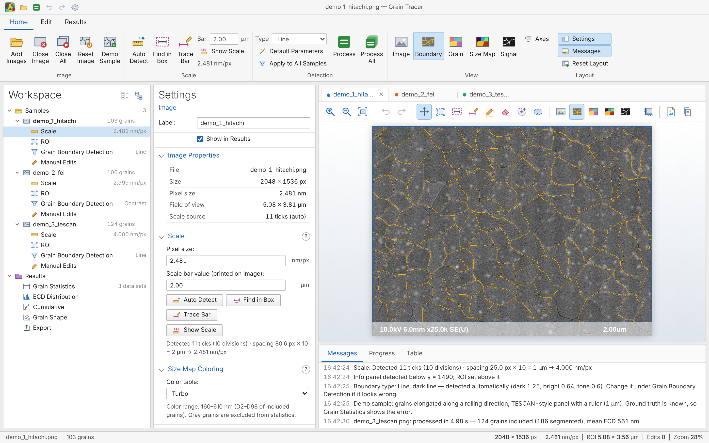
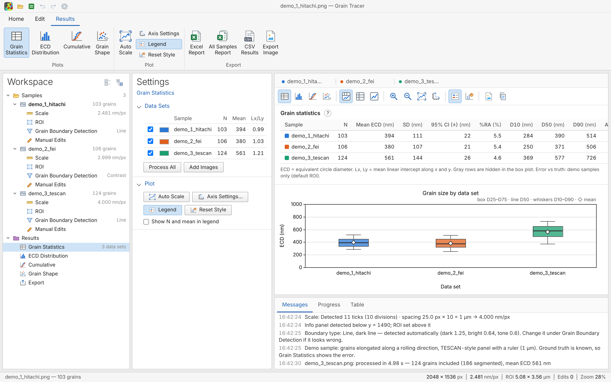
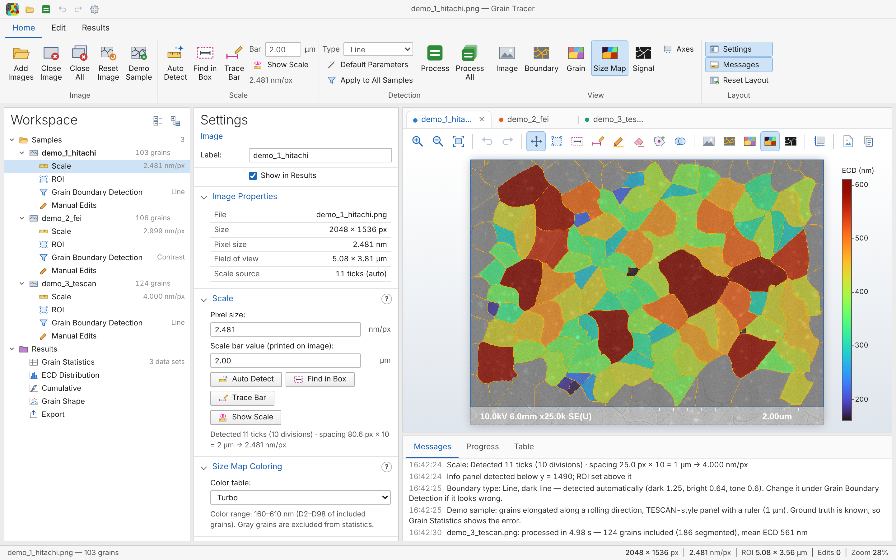
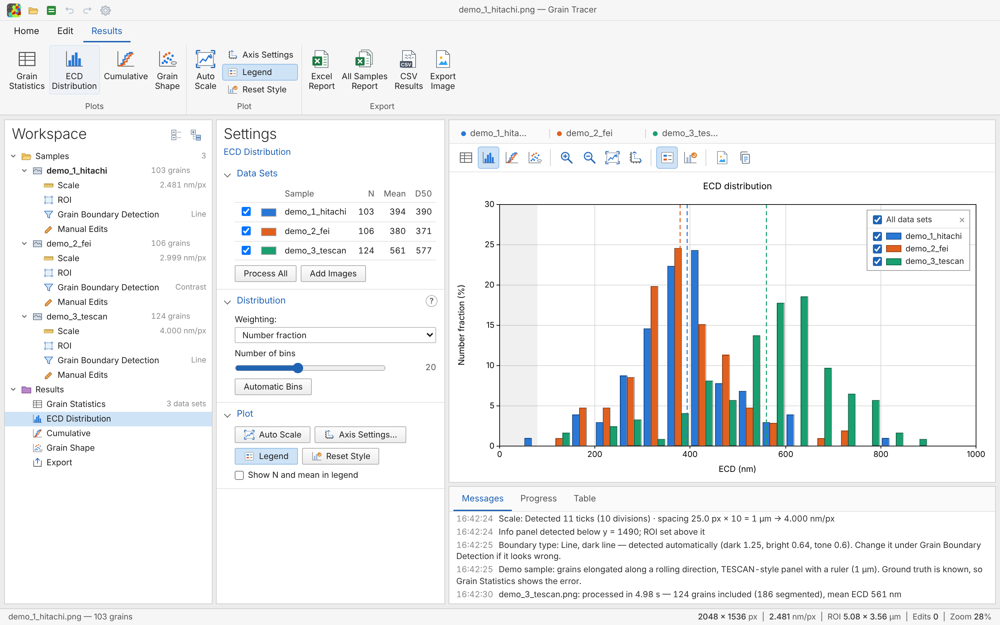
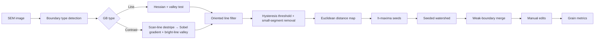

# Grain Tracer

**Detects grain boundaries in SEM images and quantifies grain size distributions (ECD) on the same basis as EBSD.**

Runs as a macOS app, a Windows app or in a browser (`index.html`). All three use the same code, and image data never leaves your computer.



---

## Background

While crystallizing a-Si thin films with a UV nanosecond laser, I needed to compare grain size across fluence, shot count and scan direction. EBSD required external measurement requests, so not every condition could be measured. Analyzing the SEM images in ImageJ (intensity thresholding) picked up the glow next to boundaries and bright spots inside grains as boundaries, so manual correction was always needed.

Grain Tracer was built to **complement EBSD and compare every condition on the same basis**, with an algorithm designed around the signal characteristics of these SEM images.

## Features

| | |
|---|---|
| **Boundary detection** | `Line` mode (crack/groove-type boundaries, dark or bright) and `Contrast` mode (boundaries seen as tone steps between grains). The type and line tone are **detected automatically** when an image opens |
| **Automatic scale** | Detects dotted tick bars (Hitachi), solid bars and bars in an inset box, also when a boundary or particle crosses the ticks; reads `PixelSize` from Hitachi `.txt` files |
| **Physical-unit parameters** | All default parameters are defined in nm, so images at different magnifications are analyzed with the same criteria |
| **Manual correction** | Draw boundary, erase boundary, split grain, merge grains. Edits are stored as coordinates and persist when you reprocess with new parameters |
| **Metrics** | N, mean and SD, **95 % confidence interval and %RA**, D10/D50/D90, area-weighted ECD, aspect ratio, linear intercept Lx and Ly |
| **Reliability check** | Flags results that are hard to trust: grains under ~75 px across, fewer than 50 grains, or %RA above 10 % |
| **Statistics table** | One table of every sample on the Result canvas, above the box plot (or table / plot only) |
| **Visualization** | Boundary / Grain / Size Map (Turbo, Jet, Viridis, Plasma) / Signal views; box plot, number- and area-fraction histograms, cumulative distribution and grain shape plots |
| **Multiple samples** | Open several images at once, run Process All, and copy detection settings with Apply to All Samples (converted in nm). Each plot keeps its own selection of samples; Minimum ECD is set per sample |
| **Help** | `?` buttons open short explanations with diagrams, in English or Korean |
| **Desktop apps** | macOS: native window and menus, Open With from Finder, save panels. Windows: WebView2 window, Open with / drag onto the exe, save dialogs. Both read a Hitachi `.txt` with the same name |
| **Export** | Excel report (summary page with images, figures, grain table), All Samples report (comparison sheet + one sheet per sample), CSV results, image export (PNG, JPG, WebP) with preview, copy to clipboard |
| **Input formats** | TIF (including Hitachi palette TIF with deflate compression), PNG, JPG |







## Getting started

### macOS app

**Download**: get `GrainTracer-<version>-macOS.zip` from [Releases](../../releases/latest), unzip it and move the app to Applications. Runs on Apple Silicon and Intel Macs (macOS 12 or later).

- The app is not notarized, so macOS blocks the first launch. On macOS 14 and earlier, right-click the app ▸ **Open**. On macOS 15 and later, try to open it once, then click **Open Anyway** in **System Settings ▸ Privacy & Security**.

**Build from source**: only the Command Line Tools are needed, no Xcode project.

```bash
xcode-select --install   # once, if swiftc is missing
./build.sh               # → build/Grain Tracer.app
open "build/Grain Tracer.app"
```

- Open images with `File ▸ Open Image…` (⌘O), **Open With** in Finder, or by dropping them on the Dock icon. A Hitachi `.txt` with the same name is read automatically.
- Exports are saved through the macOS save panel.

### Windows app

**Download**: get `GrainTracer-<version>-Windows.zip` from [Releases](../../releases/latest), unzip it anywhere and run `GrainTracer.exe`. Runs on Windows 10 and 11 (64-bit).

- The app is not signed, so SmartScreen may warn on the first launch: click **More info ▸ Run anyway**.
- It uses the Microsoft Edge WebView2 Runtime, which is part of Windows 11 and current Windows 10. If it is missing, the app shows a link to install it.
- Open images with **Add Images**, by dragging them onto the window, or with **Open with** in Explorer. Exports are saved through the Windows save dialog.

**Build**: GitHub Actions (`.github/workflows/release.yml`) builds it on a version tag, so no Windows PC is needed. To build on Windows yourself, install the .NET SDK and run `dotnet build win/GrainTracer.csproj -c Release -o out/GrainTracer`.

### Browser

Open `index.html` in Chrome, Edge or Safari. It works offline with no external CDN, and can be hosted on GitHub Pages.

### Workflow

1. **Add Images** or drag & drop SEM images. Several can be opened at once; each appears under **Samples** in the Workspace.
2. **Scale**: the bar is measured automatically. Check that `Bar` matches the value printed on the image (e.g. `2.00`, `3.00` µm).
3. **Grain Boundary Detection**: the boundary type is chosen automatically (see Messages). Click **Process** (current sample) or **Process All**. Settings tuned on one sample can be copied with **Apply to All Samples**.
4. Correct with Draw GB / Erase GB / Split / Merge on the **Edit** tab if needed. Set **Minimum ECD** for each sample under ROI ▸ Grain Filter.
5. Enter the condition in each sample's **Label** (e.g. `340 mJ/cm² · 800 shots`); it is used in tables and legends. Compare samples on the **Results** tab and export an Excel report, CSV or images.

> **Demo Sample** opens a synthetic image with known ground truth (five styles), so you can check the result and its error.

### Layout

| Area | Contents |
|---|---|
| Ribbon | Home (image, scale, detection, view, layout), Edit (correction tools), Results (plots, export) |
| Workspace | Samples (Scale, ROI, Grain Boundary Detection, Manual Edits of each sample) → Results (Grain Statistics, ECD Distribution, Cumulative, Grain Shape, Export) |
| Settings | Settings of the selected node; `?` opens help |
| Canvas | SEM image with overlay, or the statistics table and plots for all samples |
| Messages / Progress / Table | Log, step progress, grain list |

### Shortcuts

| Key | Action | Key | Action |
|---|---|---|---|
| `V` | Pan | `B` | Draw boundary |
| `R` | ROI (drag corners and edges to resize) | `E` | Erase boundary |
| `S` | Scale line (snaps horizontal/vertical, `Alt` for free angle) | `A` | Split grain |
| `M` | Merge two grains | `F` | Fit |
| `I` (hold) | Show the original image | `Space`+drag | Temporary pan |
| `⌘Z` / `Ctrl+Z` | Undo | `⌘⇧Z` / `Ctrl+Y` | Redo |
| `⌘O` / `Ctrl+O` | Open image | `⌘⇧C` / `Ctrl+Shift+C` | Copy view or plot to clipboard |
| `Esc` | Cancel merge selection | | |

## Algorithm



0. **Boundary type detection** — Measures the strength of dark lines, bright lines and regional tone steps against the pixel noise, then picks `Line` (dark or bright) or `Contrast`. Bright lines are chosen only when clearly stronger than dark ones, so dark boundaries with a bright halo stay `dark`.
1. **Valley filter (Line mode)** — The boundary normal is taken from the Hessian eigenvector. A pixel counts as boundary only when the points ±2σ on **both** sides of the normal are brighter than the center.
   `R = min(I(p + d·n), I(p − d·n)) − I(p)` (dark line)
   This rejects the rims of bright spots and glow edges, which are bright on one side only.
2. **Oriented line filter** — Averages along a fixed length in 12 directions and takes the maximum. Short point noise is suppressed and only continuous boundaries remain.
3. **Hysteresis threshold** — Pixels above `Start level` are boundaries; pixels between `Continue level` and `Start level` are kept only if connected to a strong boundary.
4. **Distance map + h-maxima seeds** — Maxima of height ≥ h in the distance-to-boundary map become grain seeds, so grains are separated even where boundaries are partly broken.
5. **Seeded watershed** — Priority flood on a relief combining boundary signal and distance.
6. **Weak-boundary merge** — Adjacent grains are merged when the mean boundary signal between them is below the threshold, reducing over-segmentation.

### Default parameters (Line mode, in nm → converted from the image pixel size)

| Parameter | Default | Meaning |
|---|---|---|
| Boundary width σ | 4.75 nm | Width of boundary lines to detect |
| Line length filter | 60 nm | Only lines at least this long count as boundaries |
| Start / Continue level | 0.50 / 0.18 | Hysteresis thresholds |
| Split depth h | 8 nm | Larger values split grains less |
| Weak-boundary merge | 0.15 | Merge threshold for weak boundaries |
| Computation scale | Auto | Downsampling for computation (≈4 nm/px) |

## Metrics

| Metric | Definition |
|---|---|
| **ECD** | Equivalent circle diameter, `ECD = 2√(A/π)` — same grain size definition as EBSD software |
| **95 % CI, %RA** | Half-width of the 95 % confidence interval of the mean ECD (t-distribution), and `%RA = CI / mean`. %RA ≤ 10 % is the usual target (ASTM E1382) |
| **Number fraction** | Grains in a bin / total grains |
| **Area fraction** | Total grain area in a bin / total area |
| **Area-weighted ECD** | `Σ(ECDᵢ·Aᵢ) / ΣAᵢ` |
| **Aspect ratio, angle** | Major/minor axis of the equivalent ellipse from second moments, and major-axis direction |
| **Lx, Ly** | Mean linear intercept along x and y test lines (ASTM E112 intercept method). `Lx/Ly` indicates scan-direction anisotropy |

- By default, grains touching the ROI edge are excluded from statistics for all samples, so comparisons share the same basis. Grains below `Minimum ECD` (default 80 nm) are excluded per sample.

## Validation

Real SEM images have no ground truth, so the algorithm was validated on **synthetic SEM images** with known boundary positions — an approach used for evaluating SEM measurement algorithms [1] and in grain segmentation studies [2]. Detected grains were matched to true grains (IoU ≥ 0.5) in 156 runs.

- **Accuracy** (5 image styles × 8 random seeds): grain-matching F1 0.89 on average. Error against the true values: **linear intercept +1.1 ± 4.8 %**, **area-weighted ECD +1.8 ± 4.6 %**, mean ECD −5.0 ± 5.8 %. Matched grains have a median size error under 1 %; the remaining error comes from split or merged grains, which mainly affects the number mean.
- **Scale**: automatic pixel size within 0.16 % of the set value.
- **Robustness**: flips and rotations, 0.5–1.5× magnification, contrast, gamma and uneven illumination changed the mean ECD by up to ~3 % in the line-boundary styles; added noise and blur lowered F1 gradually. Each detection parameter at ±20 % changed the mean ECD by about ±2 % (up to ~8 % for coarse grains with bright boundaries).
- **Limit**: accuracy drops for grains under ~75 px across (F1 0.70 at 45 px). Computation scale 1/1 with shorter line length and boundary width recovers it (F1 0.88–0.91); the app warns in this range.
- **Boundary type detection**: correct in all 20 synthetic test images.

- [ ] Same-area SEM vs. EBSD comparison (planned)

## Limitations

- The algorithm was designed around Hitachi SE images of laser-crystallized a-Si films. Other materials or detectors may need parameter tuning.
- Grains with dense surface texture (dots, speckle) can be over-split; raise `Line length filter` or `Start level`, or correct by hand.
- Contrast mode can miss boundaries between grains of similar brightness, which then need manual correction.
- The scale bar number (e.g. `2.00um`) is not read by OCR, so check the value yourself.
- Synthetic validation reflects accuracy under the modeled conditions; accuracy on real samples needs separate confirmation against EBSD or manual counting.

## Project structure

```
GrainTracer/
├── index.html            # Browser build (generated by tools/build_web.py)
├── build.sh              # macOS app build (Universal, Command Line Tools)
├── package.sh            # Release zip → dist/
├── RELEASE_NOTES.md      # GitHub Release body
├── LICENSE               # MIT
├── .github/workflows/    # release.yml builds the macOS and Windows apps and publishes the Release on tag push
├── src/
│   ├── gbcore.js         # Core algorithms (also runs in Node.js)
│   ├── app.js            # UI, statistics, plots, export
│   ├── help.js           # Help pop-ups (English / Korean)
│   └── ui.html           # Layout and styles
├── vendor/               # UTIF.js, pako (TIFF decoding, MIT)
├── mac/
│   ├── main.swift        # WKWebView-based macOS shell (open/save panels, menus)
│   ├── Info.plist
│   └── icon_1024.png
├── win/
│   ├── Program.cs        # WebView2-based Windows shell (save dialogs, Open with)
│   ├── GrainTracer.csproj
│   ├── app.manifest
│   └── icon.ico          # Generated from mac/icon_1024.png
├── tools/
│   ├── build_web.py      # src + vendor → index.html
│   └── make_ico.py       # mac/icon_1024.png → win/icon.ico
└── docs/                 # README images (generated from the synthetic samples)
```

After editing the code, rebuild `index.html` with `python3 tools/build_web.py` and the app with `./build.sh`.

**Releases**: pushing a tag like `v1.1.0` makes GitHub Actions (`release.yml`) build the macOS and Windows apps and attach both zips to one Release, with `RELEASE_NOTES.md` as its text. To build locally, run `./build.sh && ./package.sh`; the zip goes to `dist/`.

## Tech stack

Vanilla JavaScript (Canvas 2D, Typed Arrays) · Swift + WKWebView (macOS shell) · C# + WebView2 (Windows shell) · [UTIF.js](https://github.com/photopea/UTIF.js), [pako](https://github.com/nodeca/pako) (TIFF decoding) · No server

## References

1. P. Cizmar, A. E. Vladár, B. Ming, M. T. Postek, "Simulated SEM images for resolution measurement," *Scanning* **30**, 381–391 (2008).
2. Warren et al., "Grain and grain boundary segmentation using machine learning with real and generated datasets," arXiv:2307.05911 (2023).
3. P. F. Felzenszwalb, D. P. Huttenlocher, "Distance transforms of sampled functions," *Theory of Computing* **8**, 415–428 (2012).
4. L. Vincent, "Morphological grayscale reconstruction in image analysis," *IEEE Trans. Image Process.* **2**, 176–201 (1993).
5. ASTM E112, *Standard Test Methods for Determining Average Grain Size*.
6. ASTM E1382, *Standard Test Methods for Determining Average Grain Size Using Semiautomatic and Automatic Image Analysis*.

## License

[MIT](LICENSE)
