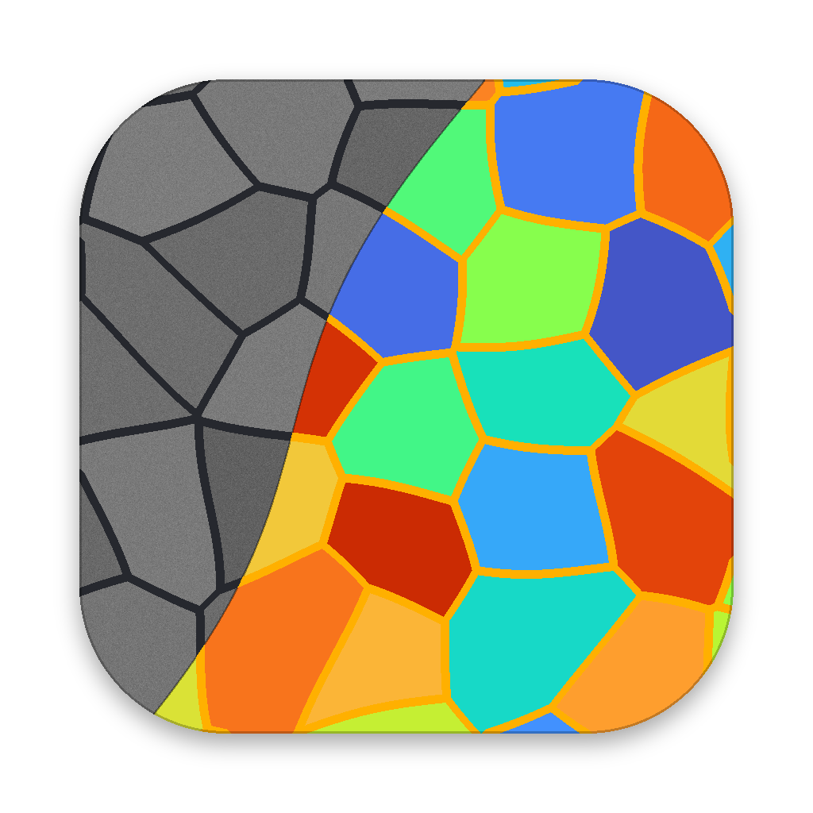

<p align="center">
  
</p>

<h1 align="center">Grain Tracer</h1>
<p align="center"><i>Grain size from SEM images, on the same basis as EBSD.</i></p>

Grain Tracer finds grain boundaries in SEM images and measures the grain size distribution as ECD (equivalent circle diameter), the same definition EBSD software uses. Open several samples, check the boundaries, fix them by hand where needed, and compare every sample in one table and one set of plots.

It runs as a macOS app, a Windows app or a single `index.html` in the browser. All three use the same code. No account, no server, and images never leave your computer.


## Background

While crystallizing a-Si thin films with a UV nanosecond laser, I needed to compare grain size across fluence, shot count and scan direction. EBSD needed external measurement requests, so not every condition could be measured. Thresholding the SEM images in ImageJ picked up the glow next to boundaries and bright spots inside grains, so every image needed manual correction.

Grain Tracer was built to **complement EBSD and compare every condition on the same basis**, with an algorithm designed around the signal of these SEM images.

## Features

- **Boundary detection**: `Line` mode for crack or groove boundaries (dark or bright) and `Contrast` mode for tone steps between grains. The type is detected automatically when an image opens.
- **Automatic scale**: reads dotted tick bars (Hitachi), solid bars and bars in an inset box, even when a boundary crosses the ticks. A Hitachi `.txt` with the same name is used first.
- **Same criteria at any magnification**: every default parameter is defined in nm and converted from the pixel size.
- **Manual correction**: draw, erase, split and merge. Edits are stored as coordinates, so they stay when you process again with new parameters.
- **Statistics table**: every sample in one table with N, mean, SD, 95 % CI, %RA, D10/D50/D90, area-weighted ECD, linear intercept Lx and Ly, and aspect ratio.
- **Reliability check**: flags grains under ~75 px across, fewer than 50 grains, or %RA above 10 %.
- **Plots**: box plot, number- and area-fraction histograms, cumulative distribution and grain shape. Each plot keeps its own choice of samples.
- **Excel reports**: one report per sample (images, histogram, figures, grain table) or one for all samples. CSV for MATLAB, Python and Origin.
- **Images**: Boundary, Grain, Size Map (Turbo, Jet, Viridis, Plasma) and Signal views. Export as PNG, JPG or WebP, or copy to the clipboard with ⌘⇧C.
- **Help**: `?` buttons open short explanations with diagrams, in English or Korean.
- **Inputs**: TIF (including Hitachi palette TIF), PNG, JPG.

| Statistics | Size map |
|---|---|
|  |  |
| **ECD distribution** | **Main window** |
|  |  |

## Install

### macOS

1. Get the latest `GrainTracer-x.y.z-macOS.zip` from [Releases](../../releases) and unzip it.
2. Move `Grain Tracer.app` to `/Applications`.
3. The app is not notarized, so macOS blocks the first launch. Open **System Settings → Privacy & Security** and click **Open Anyway**, or run:
   ```bash
   xattr -dr com.apple.quarantine "/Applications/Grain Tracer.app"
   ```
4. Open images with **File → Open Image…** (⌘O), **Open With** in Finder, or by dropping them on the Dock icon.

### Windows

1. Get the latest `GrainTracer-x.y.z-Windows.zip` from [Releases](../../releases) and unzip it anywhere.
2. Run `GrainTracer.exe`. The app is not signed, so SmartScreen may warn: click **More info → Run anyway**.
3. Open images with **Add Images**, by dragging them onto the window, or with **Open with** in Explorer.

It uses the Microsoft Edge WebView2 Runtime, which comes with Windows 11 and current Windows 10. If it is missing, the app shows a link to install it.

### Browser

Open `index.html` in Chrome, Edge or Safari. It works offline and can be hosted on GitHub Pages.

### Build from source

macOS needs only the Xcode Command Line Tools (no Xcode).

```bash
xcode-select --install        # skip if already installed
git clone https://github.com/HongHyun-kr/Grain-Tracer.git
cd Grain-Tracer
bash build.sh                 # → build/Grain Tracer.app
open "build/Grain Tracer.app"
```

`bash build.sh --zip` also creates `dist/GrainTracer-<version>-macOS.zip` for a release.

Windows is built by GitHub Actions, so no Windows PC is needed. To build it on Windows yourself, install the .NET SDK and run `dotnet build win/GrainTracer.csproj -c Release -o out/GrainTracer`.

## Usage

1. **Add Images** or drag SEM images in. Each one appears under **Samples** in the Workspace.
2. **Scale**: check that the scale bar value matches the number printed on the image (e.g. `2.00` µm). The number itself is not read.
3. **Process** the current sample or **Process All**. Settings tuned on one sample can be copied with **Apply to All Samples**.
4. Fix boundaries on the **Edit** tab if needed, and set **Minimum ECD** for each sample under ROI → Grain Filter.
5. Give each sample a **Label** (e.g. `340 mJ/cm² · 800 shots`), compare them on the **Results** tab and export.

**Demo Sample** opens a synthetic image with known boundaries (five styles), so you can see the result next to its true value.

| Key | Action | Key | Action |
|---|---|---|---|
| `V` | Pan | `B` | Draw boundary |
| `R` | ROI | `E` | Erase boundary |
| `S` | Scale line | `A` | Split grain |
| `M` | Merge two grains | `F` | Fit |
| `I` (hold) | Show the original image | `Space` + drag | Temporary pan |
| `⌘Z` / `Ctrl+Z` | Undo | `⌘⇧Z` / `Ctrl+Y` | Redo |
| `⌘O` / `Ctrl+O` | Open image | `⌘⇧C` / `Ctrl+Shift+C` | Copy view or plot |

## Requirements

- macOS 12 Monterey or later (Apple Silicon; Intel when built as a universal binary)
- Windows 10 or 11, 64-bit
- Any current Chrome, Edge or Safari for `index.html`

## Data

| | Location |
|---|---|
| Images and results | Only where you save them. Nothing is uploaded |
| macOS settings | `~/Library/WebKit/com.honghyun.graintracer` |
| Windows settings | `%LOCALAPPDATA%\GrainTracer` |

Settings are only view preferences such as the help language and the table layout. Delete the folder to start fresh.

## Validation

Real SEM images have no ground truth, so the algorithm was checked on **synthetic SEM images** with known boundaries [1, 2]. Detected grains were matched to true grains (IoU ≥ 0.5) in 156 runs.

| Measure | Error against the true value |
|---|---|
| Linear intercept Lx, Ly | **+1.1 ± 4.8 %** |
| Area-weighted ECD | **+1.8 ± 4.6 %** |
| Mean ECD | −5.0 ± 5.8 % |
| Grain matching F1 | 0.89 |
| Pixel size from the scale bar | within 0.16 % |

- Matched grains have a median size error under 1 %. The remaining error comes from grains that are split or merged, which mostly affects the number mean.
- Flips, rotations, 0.5–1.5× magnification, contrast, gamma and uneven lighting changed the mean ECD by up to about 3 %. Each parameter at ±20 % changed it by about ±2 %.
- Accuracy drops for grains under ~75 px across (F1 0.70 at 45 px). The app warns in this range.
- The boundary type was detected correctly in all 20 synthetic test images.

## Limitations

- The algorithm was designed around Hitachi SE images of laser-crystallized a-Si films. Other materials or detectors may need parameter tuning.
- Grains with dense surface texture (dots, speckle) can be over-split. Raise `Line length filter` or `Start level`, or fix them by hand.
- `Contrast` mode can miss boundaries between grains of similar brightness.
- Synthetic validation shows accuracy under modeled conditions. Accuracy on real samples needs a separate check against EBSD or manual counting.

## Project layout

```
index.html          browser build (made by tools/build_web.py)
src/                gbcore.js (algorithms), app.js (UI, statistics, plots, export), help.js, ui.html
vendor/             UTIF.js and pako for TIFF decoding (MIT)
mac/                main.swift (WKWebView shell, open/save panels, menus), Info.plist, icon_1024.png
win/                Program.cs (WebView2 shell, save dialogs, Open with), GrainTracer.csproj, icon.ico
tools/              build_web.py (src → index.html), make_ico.py (mac icon → win/icon.ico)
build.sh            builds the macOS app, makes the .icns and signs it; --zip makes the release zip
.github/workflows/  release.yml builds both apps on a version tag and publishes the Release
docs/               screenshots for this README (synthetic samples)
```

After editing `src/`, run `python3 tools/build_web.py` to rebuild `index.html`, then `bash build.sh` for the app.

## How it works

- **One page, three shells**: the whole tool is `index.html`. The macOS app wraps it in `WKWebView` and the Windows app in WebView2. Exports go through the native save panel and opened files are passed in from the shell.
- **Boundary type**: the strength of dark lines, bright lines and tone steps is compared with the pixel noise to pick `Line` (dark or bright) or `Contrast`.
- **Valley filter**: the boundary normal comes from the Hessian. A pixel counts as boundary only when both sides along the normal are brighter, `R = min(I(p + d·n), I(p − d·n)) − I(p)`, so the one-sided rims of bright spots and glow are rejected.
- **Line filter**: averages along 12 directions and keeps the maximum, so short specks fade and continuous lines remain.
- **Hysteresis**: pixels above `Start level` become boundary and grow through connected pixels above `Continue level`.
- **Seeded watershed**: h-maxima of the distance-to-boundary map seed the grains, so grains separate even where a boundary is broken [3, 4].
- **Weak-boundary merge**: neighbours are joined when the mean signal on their shared boundary is below the threshold.
- **Metrics**: ECD = 2√(A/π), area-weighted ECD = Σ(ECD·A)/ΣA, linear intercept along x and y [5], and a 95 % CI with %RA = CI / mean [6].

| Parameter | Default | Meaning |
|---|---|---|
| Boundary width σ | 4.75 nm | Width of the lines to detect |
| Line length filter | 60 nm | Only lines at least this long count |
| Start / Continue level | 0.50 / 0.18 | Hysteresis thresholds |
| Split depth h | 8 nm | Larger values split grains less |
| Weak-boundary merge | 0.15 | Merge threshold for weak boundaries |
| Minimum ECD | 80 nm | Smaller grains are left out of the statistics |

## Releasing

Push a version tag. GitHub Actions builds the macOS and Windows apps and publishes one Release with both zips and `RELEASE_NOTES.md` as its text.

```bash
git tag v1.1.0
git push origin v1.1.0
```

To make the macOS zip by hand, run `bash build.sh --zip` and attach `dist/GrainTracer-x.y.z-macOS.zip`. Always upload the zip, not the `.app` itself, so the app keeps its executable permission.

## References

1. P. Cizmar, A. E. Vladár, B. Ming, M. T. Postek, "Simulated SEM images for resolution measurement," *Scanning* **30**, 381–391 (2008).
2. Warren et al., "Grain and grain boundary segmentation using machine learning with real and generated datasets," arXiv:2307.05911 (2023).
3. P. F. Felzenszwalb, D. P. Huttenlocher, "Distance transforms of sampled functions," *Theory of Computing* **8**, 415–428 (2012).
4. L. Vincent, "Morphological grayscale reconstruction in image analysis," *IEEE Trans. Image Process.* **2**, 176–201 (1993).
5. ASTM E112, *Standard Test Methods for Determining Average Grain Size*.
6. ASTM E1382, *Standard Test Methods for Determining Average Grain Size Using Semiautomatic and Automatic Image Analysis*.

## License

[MIT](LICENSE) © 2026 [HongHyun-kr](https://github.com/HongHyun-kr)
